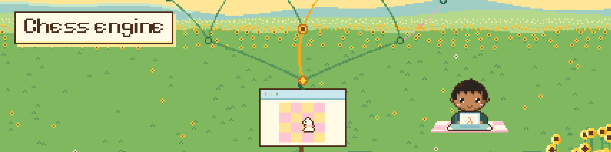

<p align="center"></p>

# Chess engine

Chess engine in Rust with alpha-beta search and UCI, and a browser board that runs it as WebAssembly.

[Live demo](https://varunswaika.github.io/chess-engine/) · [MIT licence](LICENSE)

The engine knows the full rules,
searches ahead with alpha-beta, speaks UCI so it can be plugged into any chess GUI, and runs in
the page as WebAssembly.


## Results

- **About 2800** on Stockfish's strength-limited `UCI_Elo` scale, at 10 s + 0.1 s a game (95%
  interval 2750 to 2845, from 180 games). `STRENGTH.md` says how it was measured and what the
  number does and does not mean.
- **405 million positions a second** in move generation alone (perft 5 from the start position).
- Every idea beyond plain alpha-beta was kept only if it won a self-play match against the
  version without it. In the last round four of eleven ideas passed, and together they gained
  100 Elo against the version before.
- The move generator matches the published perft counts for the six standard test positions.

**Stack:** Rust with no dependencies, compiled to WebAssembly for the page; plain JavaScript and
CSS, no framework; the UCI protocol for chess GUIs.

## The idea

The original was a two-player chess board written in Python with Pygame in 2021. Its first version
only listed where each piece could go and knew nothing about check. The rewrite that followed did
the hard part properly: it looked outward from the king, recorded every check and every pinned
piece, noted double check, and then let each piece move only where those facts allowed. It came
with a small script that counted positions several moves deep to see whether the generator was
right, and an `ai.py` that got as far as an empty piece-square "map" and a loop to add it up. This
version keeps that generator design, turns the counting script into a real test, and finishes the
opponent.

## How it works

There is one engine, written in Rust, in `engine/`. It is a library with no dependencies; the
UCI program, the match runner and the WebAssembly build for the page are thin layers over it.
An earlier version of this project had the engine in JavaScript; `STRENGTH.md` compares the two.

**Board** (`bitboard.rs`, `position.rs`). A set of squares is one 64-bit word, one bit per
square, so "all white pawns" or "every square a knight attacks" is a single number and
combining sets is a single instruction. Bishop and rook attacks use magic bitboards: the pieces
standing on the slider's lines are multiplied by a constant that gathers them into a table
index, and the table holds the attack set. The constants are found at start-up. A move is 16
bits; moves are made and unmade in place, and the undo stack doubles as the game history.

**Legal moves** (`movegen.rs`). The original design, in bitboard form. One look outward from
the king along the eight lines, plus the knight and pawn squares, gives three things:

- the checking pieces;
- for a single check, the squares that answer it (the checker and the squares between);
- the pinned pieces, each with the line it is pinned on.

Then: in double check only the king moves; in single check other pieces may only land on an
answering square; a pinned piece may only move along its pin. King moves are tested with the
king lifted off the board, so it cannot hide behind itself. En passant is the one move that is
simply tried, because it removes two pawns from one rank at once. No other move is ever made
and then checked.

**Rules that end the game** (`game.rs`). Checkmate, stalemate, threefold repetition, the
fifty-move rule and insufficient material. Positions are compared by a 64-bit Zobrist hash
updated move by move. The en passant square is recorded only when a capture is actually
possible, so repetition is counted the way the rules define it.

**Evaluation** (`eval.rs`). Every term has a middlegame and an endgame value, blended by how
much material is left. Material and a table per piece for where it stands well are kept up to
date as moves are made. On top of that: mobility, doubled, isolated and passed pawns, the
bishop pair, rooks on open files, king safety, threats, king distance to passed pawns, tempo,
knight outposts, and, in a won ending without pawns, driving the losing king to the edge. The weights
are tuned by Texel's method on 1.37 million positions from the engine's own games
(`weights.rs`).

**Search** (`search.rs`, `tt.rs`). Iterative deepening over a principal-variation alpha-beta
search:

- aspiration windows around the previous iteration's score;
- a transposition table, with mate scores stored relative to the node;
- move ordering: table move, winning captures (judged by static exchange evaluation), killer
  moves, countermoves, history, losing captures last;
- null-move pruning, reverse futility pruning, futility pruning, late move pruning and
  exchange pruning;
- late move reductions that grow with depth and move number and shrink for moves with a good
  history, and an extension when in check;
- a quiescence search that plays out captures before evaluating;
- repetition and the fifty-move rule are seen inside the tree;
- on a clock, a soft limit that stretches when the best move has just changed and shrinks when
  it has been stable, and a hard limit that cuts off a long iteration.

Each group of ideas beyond the plain alpha-beta search was kept only after it won a self-play
match against the version without it. `STRENGTH.md` has the method and the numbers, including
what was tried and removed.

**Around the engine.** `uci.rs` is the UCI protocol: parsing and formatting as pure functions,
and a loop that reads standard input while the search runs on its own thread, so `stop` is
heard at once. `wasm.rs` is the interface for the page: text in, JSON out, through one shared
buffer, with no binding generator. It has two requests. `describe` takes a start position and
the moves played, and returns the position, how the game stands and every legal move with its
notation. `go` takes the same plus UCI `go` parameters, and returns the best move, the score
and the expected line in both notations.

**The page** (`web/`). A static site with no framework and no dependencies. It keeps no chess
rules of its own: which moves are legal, how they are written, whether the game is over and
whether a set-up position can be played are all asked of the engine. One copy of the engine
answers those questions on the main thread; two more run in Web Workers, one to play and one
to analyse.

- A search in WebAssembly cannot be interrupted from outside. Analysis therefore runs as a
  series of searches, each one ply deeper and sharing the transposition table, and gives way
  to a newer request between them; a search that must stop at once has its worker replaced.
- The weaker levels do not search less well, they choose less well: every legal move is
  scored by a shallow search, random noise is added to the scores, and the best noisy score
  is played. A forced mate is never passed up. Stronger levels search to a fixed depth, and
  the strongest has only the clock.
- Pieces slide because the board compares the position before and after: a piece that left
  one square and a piece of the same kind that appeared on another are the same piece. That
  covers castling, en passant and takebacks without the board knowing what they are.
- A premove is two squares remembered until the turn arrives, then tried against the legal
  moves.
- A review searches every position of the game once. The value of a move is the score of
  the position after it, so one search per position gives both the best move and what the
  played move cost. Scores are turned into winning chances (the curve Lichess fitted to its
  games) and a move is an inaccuracy, mistake or blunder when it gives up 10, 20 or 30
  points of winning chance.
- PGN import drops comments, variations and annotations, then matches each word against
  the notation of the legal moves.
- Opening names come from a table of about 175 lines in `eco.js`. Names and codes follow the
  Lichess openings list (in British spelling); where a line is not listed under the same
  moves, the entry for the same position reached another way is used. A game is named by the
  longest line its moves begin with.
- When a flag falls the page asks the engine about the same position with the flagged side
  reduced to its king. If that is a draw by insufficient material, the other side could never
  have mated, and the game is drawn.
- The editor offers only the castling rights and en passant squares the engine keeps when
  they are put to it, so what can be set is what can be played.
- Sounds are made with WebAudio; there are no audio files. The typefaces (the site's Newsreader,
  with IBM Plex Mono and Computer Modern as its token file names them) are bundled, so the page
  looks the same on every system.

```
engine/src/        the engine library (pure, tested)
engine/src/bin/    uci.rs (UCI engine, perft, bench), match.rs (engine against engine)
engine/tests/      perft, rules, search, the UCI program as a process
web/               the page, and engine.wasm built from the library
  app.js             connects the controls to the modules and starts the first game
  state.js           the game in hand, the settings, the engines
  play.js            starting and saving games, moves, the engine's turn, the clock
  view.js            draws the panel, the players and the review from the state
  analysis.js        the running evaluation and the review of a game
  editor.js          the board editor
  dialogs.js         new game, saved games, FEN and PGN, settings, game over
  board.js           drawing, drag and drop, premoves, arrows, keyboard
  room.js            the pixel room round the board: the table, the carved frame, the props
  pixel.js           pixel helpers, copied from varun-ui/shell/pixel.js
  game.js            the moves played and the engine's description of each position
  engine.js, worker.js, client.js   the WebAssembly engine and its workers
  pgn.js, eco.js, review.js, clock.js, text.js, levels.js   pure logic and data
  sound.js, store.js   WebAudio and localStorage
  pieces/, art/      the pixel pieces, the grain and the dither masks, made by scripts/pixel-art.mjs
bin/serve.js       a small web server for the page
test/              the page's code against the real engine.wasm
```

## Run it

Needs Node 22 or newer for the page, and Rust (stable) for everything else.

```
npm install     # only lint and format tools; the program itself has no dependencies
npm start       # then open http://localhost:8000/
```

The port comes from `PORT` (copy `.env.example` to `.env` to change it).

On the page:

- **Moving.** Drag a piece, or click it and then a marked square; both work with a mouse and
  with a finger. While the engine thinks you can line up your reply. With the board focused,
  Enter picks up and puts down and the arrow keys move between squares.
- **Drawing.** Right-click and drag for an arrow, right-click a square to mark it; Shift, Alt
  and Ctrl give other colours. On a touch screen press and hold a square that has no
  piece of yours, then drag; the arrow button makes every drag draw. A click or tap clears them.
- **New game.** Play White, Black, a random side, or both sides for two players at one board
  as in the original. Eight engine levels, from very easy to full strength, each described
  in a line; they are not matched to ratings. No clock, or one of seven time controls.
- **During a game.** Takeback, hint, offer a draw (the engine accepts when it stands worse),
  resign. The engine's evaluation is hidden while you play it, unless you switch it on. When
  the game ends a dialog says how, and offers a rematch, a review and the PGN.
- **Looking back.** Click a move or use the arrow keys; F flips the board, M mutes. Review
  marks inaccuracies, mistakes and blunders, shows the better move as an arrow, and draws the
  evaluation as a graph that can be clicked to jump. A move made while looking back at a
  finished game starts a new game from that point.
- **Position.** Copy or load FEN and PGN. The editor sets up any position the engine accepts,
  with castling rights and an en passant square, and says what is wrong with one it does not.
  A position can also be given by URL: `/web/?side=black&fen=...`.
- **Games** are kept in the browser's localStorage and can be reopened from the list.
- **Settings.** Light or dark, four board colours, sounds, coordinates, legal-move dots.

`web/engine.wasm` is checked in, so the page runs without building anything. To rebuild it
after changing the engine:

```
npm run build:wasm
```

This needs the `wasm32-unknown-unknown` target (`rustup target add wasm32-unknown-unknown`, or
your distribution's package, for example `rust-wasm` on Arch), and uses `wasm-opt` if present.

As a UCI engine, build it and give a chess GUI the program:

```
cargo build --release --manifest-path engine/Cargo.toml
engine/target/release/uci
```

Supported: `uci`, `isready`, `ucinewgame`, `setoption name Hash`, `position`, `go` (`depth`,
`nodes`, `movetime`, `wtime`/`btime`/`winc`/`binc`/`movestogo`, `infinite`, `perft`), `stop`,
`quit`.

Counting positions and timing the search from the command line:

```
npm run perft -- 5
npm run perft -- 4 "r3k2r/p1ppqpb1/bn2pnp1/3PN3/1p2P3/2N2Q1p/PPPBBPPP/R3K2R w KQkq - 0 1"
engine/target/release/uci bench 14
```

Playing two UCI engines against each other, with an Elo difference and error bars:

```
engine/target/release/match --engine1 engine/target/release/uci --engine2 "some other engine" --games 200 --tc 1+0.01
```

## Test

```
npm test              # Rust tests and the page test, a few seconds
npm run test:deep     # perft to full published depth
npm run lint          # clippy and eslint
npm run format:check  # rustfmt and prettier
```

The tests are few on purpose. The move generator is checked against the published node counts
for the six standard perft positions, which exercises every rule of movement. The rest cover the
ways a game ends, a handful of search results (forced mates, a basic endgame mate, an
evaluation that is the same for both colours), the UCI program run as a real process, and the
page's logic against the real `engine.wasm`: a game played through it, PGN out and back, the
review's marks, the clock, a flag fall that is a draw, every line of the opening table, and
the weak levels' choice of move.

## Limits

Draws by repetition and the fifty-move rule are applied automatically rather than claimed. A
flag fall is a draw only when the other side has a bare king or a single minor piece, which
is simpler than the full rule. PGN import reads the first game and
only its main line. The engine levels are not
calibrated to ratings. The engine has no opening book or endgame tables, and searches on one
thread. The evaluation is hand written with tuned weights. A small network evaluation (NNUE) is
built and works, but with the data available it lost to the hand-written one, so it is off unless
asked for (`setoption name EvalFile`). Its strength was measured only against strength-limited
Stockfish in 10-second games (about 2800 on that scale; `STRENGTH.md` says what that does and
does not mean).

## The look

The page uses the site's pixel look from the shared shell (`varun-ui/shell/`), linked in
`index.html`: its tokens, fonts, the bar, the About panel and the footer. The page is light
only, as the site is.

The board is pixel art. It is 128 art pixels wide, 16 to a square, and is shown at a
whole-number scale (the board's size is a multiple of 128 px), so every art pixel is a whole
number of screen pixels. `scripts/pixel-art.mjs` draws the pieces, the grain and the dither
masks from text grids. `room.js` draws the room on one canvas at the same scale: a lamp-lit
table, window light, the carved frame with the coordinates cut in it, and a candle, a cup of
tea, books and a plant, with small idle motion at 10 frames a second. A move is drawn in two to
four frames, 12 a second, a whole art pixel at a time; a taken piece leaves through two frames
of dither. Under reduced motion, pieces jump and nothing idles.

The site has four meaning colours, and every project maps onto them the same way:

| Role in a picture                    | Token                       | Here                                          |
| ------------------------------------ | --------------------------- | --------------------------------------------- |
| being looked at or compared          | `measured`                  | last move, inaccuracy, amber arrow            |
| moved, wrong, rejected               | `against`                   | check, mistake and blunder, red arrow, resign |
| done, the answer                     | `proved`                    | the piece picked up, the better move's arrow  |
| the current item                     | `open`                      | premove, hint arrow, the graph's cursor       |
| already seen (grey tint, no meaning) | `muted` mixed into the page | not used here                                 |

Mistake and blunder share a colour and are told apart by their signs, `?` and `??`, and on the
review strip by the size of the dot.

## Credit

Based on the Pygame chess game by Varun Agarwal, 2021: [Chess](https://github.com/varunswaika/Chess). Piece-square tables are PeSTO's, by
Ronald Friederich. The pixel pieces are drawn for this project. The fonts come with the
shared shell, with their licences in `varun-ui/shell/fonts/`. Opening names follow the Lichess openings
list (CC0). The rest of the project is under the MIT licence.

## Status

Working, as of 26 November 2026. See [STATUS.md](STATUS.md).

## Licence

MIT (see [LICENSE](LICENSE)).
