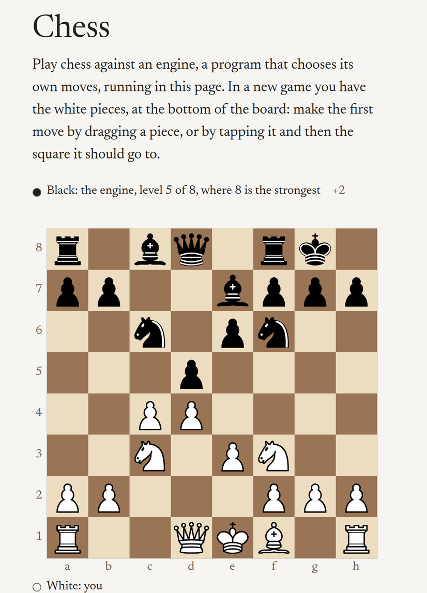

# Chess engine

A chess engine in Rust with alpha-beta search and UCI, and a browser board that runs it as WebAssembly.

**About 2790** on Stockfish's strength-limited `UCI_Elo` scale, at 10 s + 0.1 s a game (95%
interval 2748 to 2831, from 240 games). `STRENGTH.md` says how it was measured and what the
number does and does not mean.



## Try it

[varunswaika.github.io/chess-engine](https://varunswaika.github.io/chess-engine/). As a UCI engine for a chess GUI:

```
cargo build --release --manifest-path engine/Cargo.toml
engine/target/release/uci
```

## Build and test

You need Node 22 or newer and Rust (stable).

```
npm install     # lint and format tools only
npm start       # the page at http://localhost:8000/
npm test        # Rust tests and the page test
make lint       # clippy, eslint, rustfmt and prettier
```

How it works, and its limits: [docs/how-it-works.md](docs/how-it-works.md). The page, UCI options and rebuilding `engine.wasm`: [docs/usage.md](docs/usage.md).

Rewrite of a 2021 Pygame game. MIT licence.
