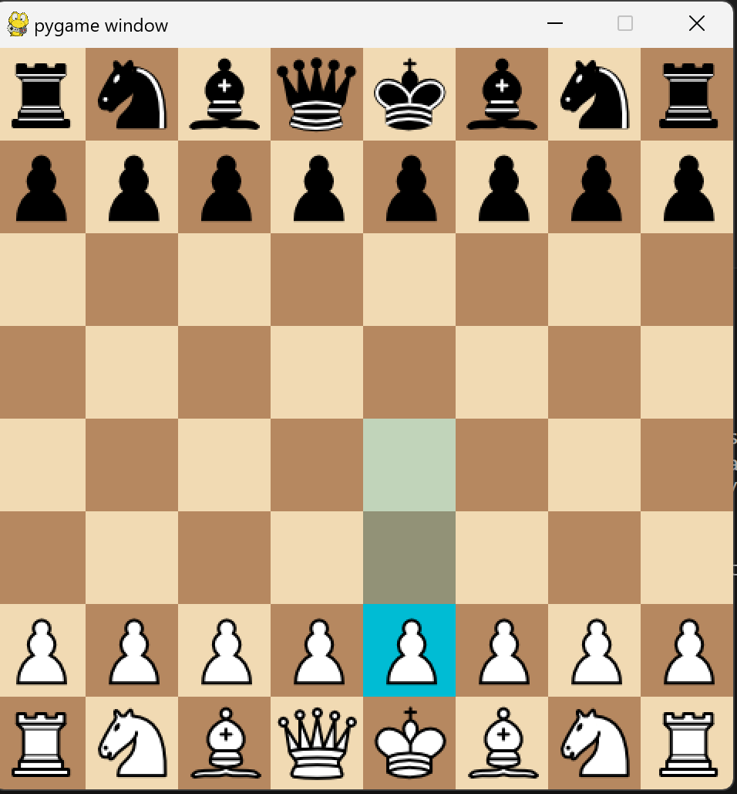

# Chess in Pygame (2021 to 2024)

A two-player chess board in Pygame, kept here as history. The Rust engine
is on `main`.



## Run it

```bash
python -m venv .venv
.venv/bin/pip install -r requirements.txt
.venv/bin/python __init__.py
```

Click a piece, then a highlighted square. Press Z to take a move back.
Tested on Python 3.14 with pygame-ce 2.5.

## Test

```bash
.venv/bin/python -m unittest test
```

The move counts from the start position match the published ones to
depth 4 (197,281).

## Known gaps

- A king that moves keeps its castling rights (a typo: `alowed`).
- Moving a rook clears the castling right on the other wing, and
  capturing a rook clears none.
- Castling is refused when the rook's square, or b1 or b8, is attacked.
- After castling, check is tested on the king's old square.
- Pawns promote to a queen only.
- A pawn that moved two squares stays open to en passant for the rest of
  the game.
- `ai.py` was started and never finished.

## History

- 28 August 2021: the first version, one file.
- February 2022: two rewrites from a laptop copy, in `laptop-2022/`.
- January 2024: the `Game` package, written in early 2022, committed.
